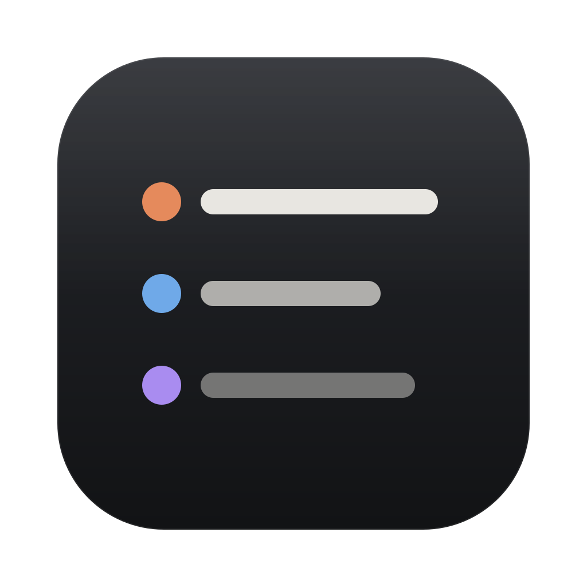
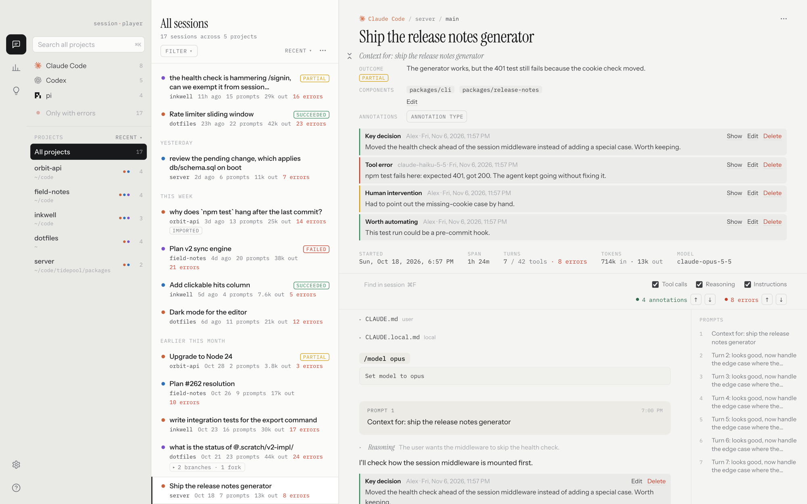
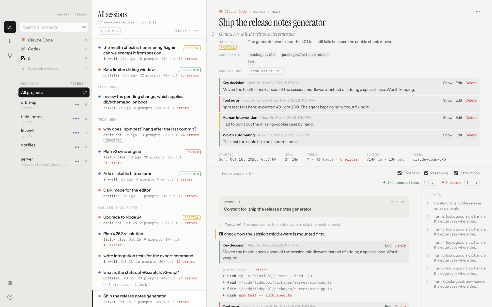
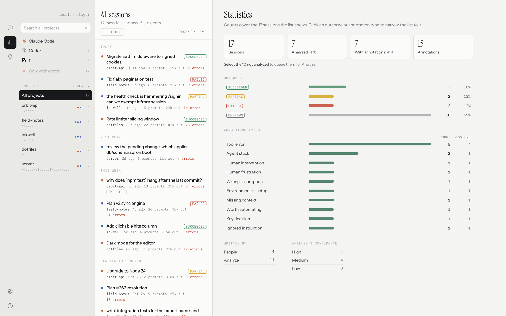
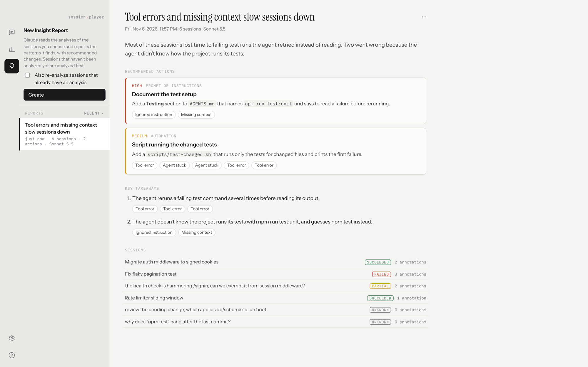

<p align="center">
  
</p>

<h1 align="center">Session Player</h1>

<p align="center">
  A Mac app for reading your coding sessions from all your agents in one place.
</p>

<p align="center">
  <a href="https://github.com/danmactough/session-player/releases/latest"><strong>Download</strong></a>
  &nbsp;·&nbsp;
  <a href="#usage">Usage</a>
  &nbsp;·&nbsp;
  <a href="#development">Development</a>
</p>

## Contents

| Usage | Development |
|---|---|
| [Install](#install)<br>[Add your sessions](#add-your-sessions)<br>[Find a session](#find-a-session)<br>[Search](#search)<br>[Read a session](#read-a-session)<br>[Continue a session](#continue-a-session)<br>[Add notes](#add-notes)<br>[Analyze sessions](#analyze-sessions)<br>[See patterns across sessions](#see-patterns-across-sessions)<br>[Get Insights](#get-insights)<br>[Share a session](#share-a-session)<br>[Settings](#settings)<br>[Keyboard shortcuts](#keyboard-shortcuts) | [Run it locally](#run-it-locally)<br>[Test](#test)<br>[Build](#build)<br>[Release](#release)<br>[Add support for a new agent](#add-support-for-a-new-agent)<br>[How it works](#how-it-works)<br>[License](#license) |

## Usage



The icons on the window's left edge switch between three views: **Transcripts** for reading sessions, **Statistics** for counts across them, and **Insights** for reports.

### Install

Download the latest `.dmg` from [Releases](https://github.com/danmactough/session-player/releases/latest) and drag Session Player to Applications. It runs on Macs with Apple silicon.

### Add your sessions

Session Player finds sessions in the usual folders for Claude Code, Codex and pi on its own, and shows new ones as they're written. To add another folder, open **Settings** (`⌘,`).

### Find a session

The sidebar narrows the list by agent and project; `⌘`-click to choose several. **Only with errors** keeps sessions that hit an error. Subagents, forks and pi branches are grouped under the session they came from.

### Search

Press `⌘K` to search titles, prompts, replies, tool calls and your notes.

### Read a session

Click a session to read it: prompts and replies, tool calls with what went in and came out, file edits as before-and-after changes, and the instruction files the agent was given, such as `CLAUDE.md`. Errors, such as an edit that didn't apply or a denied command, are marked, and the arrows by the find box step through them.

### Continue a session

The **⋯** menu at the top right of a transcript copies the command that resumes the session, or opens it in Claude, ChatGPT, T3 Code or your terminal (`⌘O`).

### Add notes



Each session can record its **outcome** (succeeded, partial, failed or unknown), the **components** of the codebase it touched, and **annotations** on particular moments, such as a tool error or a key decision. Hover over a message and click **+** to add one.

### Analyze sessions

Analyze has Claude fill in the outcome, components and annotations for you. Choose **Analyze…** from the **⋯** menu above the session list (`⌘Y`), pick sessions, and click **Analyze**. It needs Claude Code installed.

### See patterns across sessions



**Statistics** counts outcomes and annotation types across the sessions in the list, or the ones you select.

### Get Insights



In **Insights**, choose sessions and click **Get insights**. Claude reads their analysis and recommends changes to your code, agent instructions, skills, setup or automation, each linked to the notes it's based on.

### Share a session

Choose **Export…** from the **⋯** menu at the top right of a transcript to save it as a `.spsession` file, notes included. Anyone with Session Player can open it with **Import…** (`⌘⇧I`).

### Settings

Open **Settings** with `⌘,`, the gear at the bottom of the window's left edge, or **Session Player → Settings…**.

### Keyboard shortcuts

Press `?`, or click the question mark under the gear at the bottom of the window's left edge, to see every keyboard shortcut.

---

## Development

Session Player is a Tauri 2 app with a Rust backend and a React frontend.

### Run it locally

You need Node.js (CI uses version 24), Rust 1.90 or newer, and the Xcode Command Line Tools.

```bash
npm install
npm run app
```

`npm run app` starts a dev build with hot reload.

To work on layout and styling without the native shell, run `npm run dev` and open http://localhost:1420. Outside Tauri, `src/devBridge.ts` stands in for the backend with synthetic sessions.

### Test

```bash
npm run test:core   # parsers, indexing, annotations, bundles
npm run test:app    # the Tauri command layer
npm run lint        # the frontend
```

`npm test` runs only the same tests as `npm run test:app`.

To check the parsers against the sessions on your own Mac:

```bash
cd src-tauri
cargo test --release -p session-player-core --lib -- --ignored --nocapture index_local_sessions   # index real folders into /tmp, print every label
cargo test --release -p session-player-core --lib -- --ignored --nocapture parse_largest_sessions  # timing + payload size for the biggest files
```

CI runs the tests and the linter on every push to `main` and every pull request. The macOS build runs only when someone comments `/build` on a pull request.

### Build

```bash
npm run bundle
```

The app is written to `src-tauri/target/release/bundle/macos/Session Player.app`.

### Release

```bash
./build-and-publish.sh patch
```

Use `patch`, `minor`, `major` or an exact `x.y.z`. The script bumps the version with `npm version`, commits the bump, builds a signed and notarized `.dmg`, and publishes it as GitHub release `v<version>`.

- Without a bump argument, it releases the current version.
- `--no-publish` stops after building and verifying.
- It refuses to run with uncommitted changes, off `main`, or when the tag already exists.
- The version lives only in `package.json`. `src-tauri/tauri.conf.json` reads it from there.

The one-time setup (Developer ID certificate, notarization password in the keychain) is described at the top of the script.

### Add support for a new agent

Supporting a new agent means teaching the backend to read its session files, then adding it to each place the app names an agent.

1. **Write the session log parser.** Add `src-tauri/core/src/parse/<agent>.rs` with a `parse(path)` function that returns a `Parsed` (`src-tauri/core/src/model.rs`). It turns each log line into an `Event`: prompt, reply, reasoning, tool call, tool result and so on. It also fills in the session's ID, folder, title, models and token counts. Optional features depend on what the agent records: subagent links (`is_subagent`, `parent_id`), context documents (`context_event`), and errors (`is_error`, `exit_code`). If the agent attaches files to prompts in its own format, convert them in `parse::normalize_prompt`.
2. **Register the parser.** Add the agent to `Source` and `Source::as_str` in `src-tauri/core/src/model.rs`. In `src-tauri/core/src/parse/mod.rs`, teach `detect` to recognize the agent's files from their first 8 lines, and add it to `parse_file`.
3. **Find its sessions.** Add its session folder to `default_roots` in `src-tauri/core/src/index.rs`. If it keeps titles or other details outside the session file, read them in `enrich`. If it runs sessions in worktrees, fold them into their repository in `project_of`.
4. **Add the sidebar filter and icon.**
   - `src/types.ts`: add it to `Source`.
   - `src/App.tsx`: add it to `ALL_SOURCES`, which creates the button at the top left, and to the zero counts.
   - `src/components/ProjectNav.tsx`: add it to `SOURCES`, which draws the colored dots on each project.
   - `src/lib/format.ts`: add its name to `SOURCE_LABEL`.
   - `src/components/AppIcon.tsx`: add its glyph to `GLYPHS` and `GLYPH_FOR`.
   - `src/index.css`: add a `--<agent>` color in all three theme blocks, the `.src-<agent>` rules, and the `.glyph-<agent>` rule.
5. **Add the resume command.** Change both `resumeCommand` in `src/lib/format.ts` and `resume_command` in `src-tauri/src/terminals.rs`, and keep the two the same. If the agent has a desktop app, add it to `targets` and `SCHEMES` in `src-tauri/src/apps.rs`, and to `HOME_APP` in `src/components/OpenButton.tsx`.
6. **Update the text that lists the agents.** These are the note in `src/components/SettingsSheet.tsx`, the `SYSTEM` prompt in `src-tauri/core/src/generate.rs`, `source` in `docs/bundle-format.md`, the sample data in `src/devBridge.ts`, and this README.
7. **Add tests.** Add a small synthetic log to `src-tauri/core/tests/fixtures` and test it in `src-tauri/core/tests/parse.rs`, then check the parser against real sessions with the commands under [Test](#test).

The compilers catch some of these changes: `cargo build` reports missing arms in `as_str` and `parse_file`, and `npm run build` reports a missing `SOURCE_LABEL` entry, zero count or `resumeCommand` case. They don't catch the lists and string matches, such as `ALL_SOURCES`, `SOURCES`, `GLYPH_FOR` and `resume_command`.

### How it works

#### Layout

```
src-tauri/core/src/            no Tauri dependency, so its tests need no GUI libraries
  parse/{claude,codex,pi}.rs   one parser per format → normalized events
  index.rs                     scan, incremental re-index (mtime+size), SQLite + FTS5
  bundle.rs                    export/import of .spsession bundles, the imported-session library
  annotations.rs               session metadata and annotations, kept apart from the index tables
  generate.rs                  suggesting metadata and annotations with Claude Haiku via the claude CLI
  reports.rs                   reports on sets of sessions: takeaways and recommended actions, kept for good
src-tauri/src/
  lib.rs                       Tauri commands, background indexing, file watcher, spimg:// image protocol
  apps.rs                      desktop apps that can open a session
  terminals.rs                 terminals that can run a resume command
src/
  App.tsx                      sidebar, filters, search, keyboard navigation
  components/                  SessionList (virtualized), Transcript (virtualized), SettingsSheet
  devBridge.ts                 synthetic backend for previewing the UI in a browser
```

#### Index

- The index lives at `~/Library/Application Support/com.danmactough.sessionplayer/index.sqlite`, along with the list of folders and UI preferences. The Analyze log is `~/Library/Logs/com.danmactough.sessionplayer/analyze.log`, moved to `analyze.log.1` when it passes about 2 MB. Bump `INDEX_VERSION` in `index.rs` after a parser change to force a rebuild.
- Every `.jsonl` or `.jsonl.zst` file below a session folder is checked, and its format is detected from its first lines. Codex's compressed logs are streamed through Zstandard when indexed or opened, including full transcripts retained after its paginated-history migration.
- A file watcher re-indexes changed files about 1.5s after an agent writes to them.
- Search uses SQLite FTS5 full-text search over prompts, replies and tool inputs.
- Annotations and analysis are stored in the app's database, apart from the index tables, and survive **Rebuild index**.
- Each change to an annotation saves a new version, and a saved version never changes, so a report can cite one. A version is kept only while it is the current one or a report cites it. Deleting an annotation that a report cites keeps the cited versions for the report and hides the annotation everywhere else.

#### Titles

| Source | First choice | Fallbacks |
|---|---|---|
| Claude Code | `custom-title` (renamed by you) | `ai-title`, `agent-name`, `summary` record |
| Codex | `thread_name` from `~/.codex/session_index.jsonl` | — |
| pi | `session_info` name | — |

When none exist, the label comes from the first prompt that has at least three words (within the first three prompts), so a session that opens with "add" or "hooks" gets a more descriptive label. After that come the first slash command and then a subagent's type. Slash-command markup becomes `/command args`, and context the agent injected into a prompt (`<environment_context>`, `<system-reminder>`, inlined pi skills) is stripped.

#### Projects

- A session in a git repository belongs to that repository's main checkout, whether it ran in a subdirectory or in a linked worktree at any path. Submodules stay separate projects.
- Worktrees deleted from disk can't be looked up in git. Claude Code worktrees (`<repo>/.claude/worktrees/*`) and `<repo>/.worktrees/*` still fold into their repository by path.
- Codex worktrees (`~/.codex/worktrees/<hash>/<name>`) fold into the one project with the same folder name.
- The Codex app gives each chat outside a project its own folder (`~/Documents/Codex/2026-10-28/<task>`). Those chats are found from the app's list of projectless threads in `~/.codex/.codex-global-state.json` or by working inside that folder, and show as one project, `~/Documents/Codex` (or the folder set as `projectless-workspace-root`).

#### Session list

Changing what a list shows (project, project filter, agent toggles, **Only with errors**, sort, search) starts it at the top. Changes that happen under you (expanding a session, new sessions arriving, hiding or dragging a project) keep the top-most visible row in place and reflow the rest around it.

#### Transcripts

- Transcripts are re-parsed from the source file when opened (tens of ms even for 30 MB files). Embedded screenshots are served through a `spimg://` protocol instead of the IPC payload, so they load only when scrolled into view.
- Attachment cards come from pi's `<file name="…">` blocks from `@file` arguments, Claude Code's `@file` attachments and IDE "opened file" notices, and Codex's "Files mentioned" / IDE context preamble (active file, selection, open tabs). The backend rewrites all of these into pi's `<file>` form (`parse::normalize_prompt`), so one renderer handles every agent.
- `apply_patch` renders as a colored patch.
- Codex's code mode, where the model writes a JavaScript `exec` script that calls the real tools, shows the commands, file edits and MCP calls each script made (from Codex's completed-item records) instead of the script. A script that called no tools, or failed on its own, stays.
- Codex's guardian review subagent, which only approves or refuses the main agent's riskier actions, isn't listed.
- pi stores sessions as a tree. The session's own row shows the branch that ends at the last entry. Every other branch with at least one message is listed under the branch it split from (branches can have branches), and pi fork files are listed under their parent session. A branch or fork transcript starts at its split point with a link back to it; the source transcript shows a "splits off here" marker at that point, linking forward. Token totals count every branch.

#### Instructions shown in a transcript

- They come from Claude Code's instruction attachments, skill messages and subagent logs, Codex's AGENTS.md and skill messages, and pi's skills and its subagent runs' agents and project instructions. A document sent again unchanged later in the session says so.
- Each shows its file name (a skill shows its folder's name). Claude Code records the scope. For Codex and pi, a file inside the session's folder counts as the repo's, and any other file as the user's.
- pi doesn't record the system prompt of a main session, so its AGENTS.md isn't shown there. Claude Code's own system prompt isn't included.
- Exports carry them, and the export sheet lists each one.

#### Errors

- An error is an edit whose old text didn't match, a read past the end of a file, a timeout, a denied or sandboxed command, an unknown tool, or a harness or model/API error. A Codex call counts when its output opens with "<tool> failed" (`exec_command failed for …`).
- **Count failed shell commands as errors** adds non-zero exits to the counts, the filter and the navigator, except exit 1 from a search or compare command (`grep`, `rg`, `diff`, `cmp`, `test`, `git diff`, `git grep`), which means "no match" or "differs", and 141, which means the output was cut short by a pipe such as `| head`. For those only the last command of the line is checked.

#### Opening sessions in other apps

Until you pick an action, the button uses the agent's own app.

- **Claude**: a session it already ran opens with `claude://code/continue?session=local_…` (from its records in `~/Library/Application Support/Claude/claude-code-sessions`), and any other is imported with `claude://resume?session=<id>`.
- **ChatGPT**: `codex://threads/<id>`.
- **T3 Code**: `t3code://threads/<environment>/<thread>`, from `~/.t3/userdata/statev2.sqlite`.
- **Terminals**: the chosen one opens a new window (a new workspace in cmux) and runs the resume command there.
- **Icons**: agents and apps use the glyphs T3 Code uses for them (Claude, OpenAI for Codex and ChatGPT, pi, T3).

#### Analyze

- **Analyze** asks Claude Haiku for the outcome, components and annotations. It runs the `claude` command from Claude Code with no tools and the transcript passed as data.
- It also sends the context the agent was given, each document once (up to 20,000 characters each and 60,000 in all), so it can tell when the agent ignored an instruction.
- It runs with the variables your login shell exports and the `env` block of your Claude settings (`~/.claude/settings.json` and `settings.local.json`, or under `$CLAUDE_CONFIG_DIR`). When those name credentials of their own (`ANTHROPIC_API_KEY`, `ANTHROPIC_AUTH_TOKEN`, an `apiKeyHelper`, or Bedrock or Vertex), Analyze uses only them, so an LLM gateway such as LiteLLM gets its base URL, token, `ANTHROPIC_CUSTOM_HEADERS` and model mappings. Otherwise it uses your Claude Code sign-in.
- Each run replaces the outcome and components. The prompt's rules are fixed; only its "what to focus on" paragraph can be customized. Each run and each `claude` call is written to `~/Library/Logs/com.danmactough.sessionplayer/analyze.log`. Results generated from an earlier version of a growing transcript are marked as out of date. An annotation whose event isn't in the transcript any more is marked "event not found", not dropped.
- Long sessions are sent in parts and the results merged. Analysis runs in the background and can be cancelled.

#### Reports

- A report reads the outcomes, components and annotations of a set of sessions (not their titles or transcripts) and writes a title, a summary, key takeaways and recommended actions. Each action has a category (codebase, skill, instructions, environment or automation), a priority and the change to make.
- It runs the `claude` command the same way Analyze does, with Claude Sonnet unless another model is chosen. Sessions are numbered `s1`…, and annotations `a1`…, so every takeaway and action cites what it rests on; one citing nothing it was given is dropped. Large sets are sent in groups of whole sessions and the results merged.
- Reports are saved in the app's database for good and never change. Each records the version of every annotation it was given, so editing or deleting an annotation later doesn't change what the report shows. Deleting a report releases versions no other report cites.
- Code: `src-tauri/core/src/reports.rs`.

#### Bundles

- The export sheet lists the sessions, the related sessions left out (the parent of a subagent, other pi branches, unticked subagents), and every attachment, with screenshots included and file cards whose contents weren't recorded marked as omitted. Saving writes the bundle shown, unchanged.
- Export downloads images that replies link from the web into the bundle, and imported transcripts never load images from the web.
- Importing a session already in the library with different contents asks whether to replace or keep the library's copy.
- The file format and the inclusion rules are in [docs/bundle-format.md](docs/bundle-format.md).

## License

[MIT](LICENSE)
